# IFEELVOID — a Claude theme

Near-black void. Purple used like a blade, not a paint roller. Cold contrast, no pastel, no generic dark mode.

<a href="https://github.com/ifeelvoid/ifeelvoid-theme/raw/main/media/brag.mp4">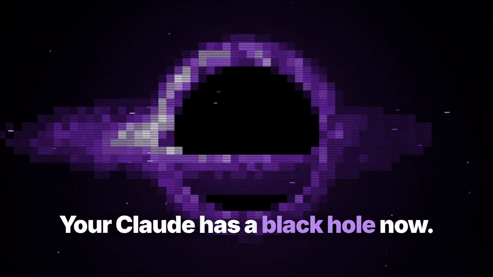</a>

**[▶ Watch the 21-second video, with sound](https://github.com/ifeelvoid/ifeelvoid-theme/raw/main/media/brag.mp4)**

Looks for the Claude desktop and mobile apps. The terminal keeps its own colors.

## Void Sky (default)

The theme follows the real sky over New York:

- **Sun** — its height is worked out on the machine every minute. Light paper while it's up, a rose-and-peach **Dawn**, a violet-to-orange **Dusk**, deep indigo **Blue Hour**, then the void for **Night**.
- **Season** — tints the paper: winter ice, spring sage, summer sand, autumn amber. At night the void leans colder in winter, warmer in autumn.
- **Weather** — from [Open-Meteo](https://open-meteo.com) every 15 minutes, no key. Clouds and fog flatten it, rain turns it slate, snow goes bright and cold, a storm pulls the void back in at noon. Only New York's city coordinates leave the machine.

The status line names the sky it's painting, e.g. `Void Sky · Dusk · Autumn · Rain`.

<table>
<tr><td width="50%">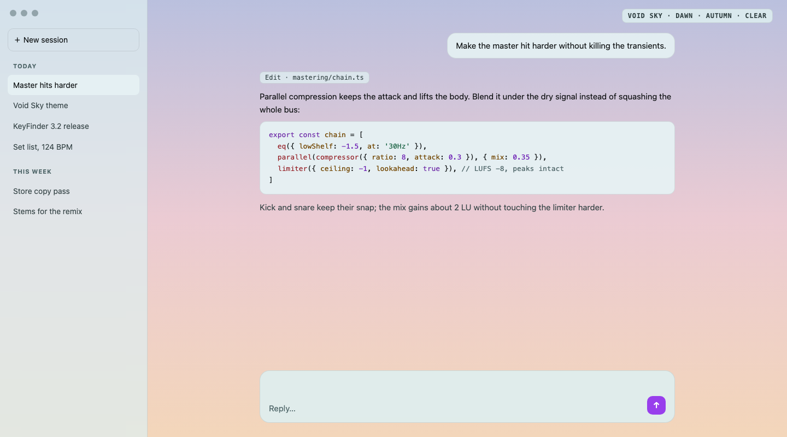<br><sub>Dawn · autumn</sub></td><td width="50%">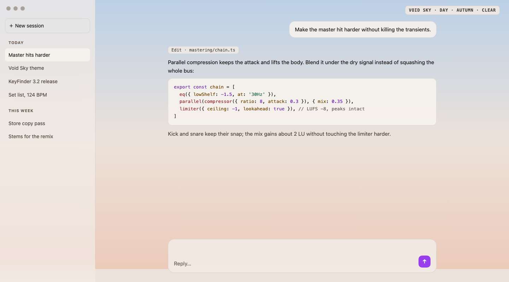<br><sub>Day · autumn</sub></td></tr>
<tr><td width="50%">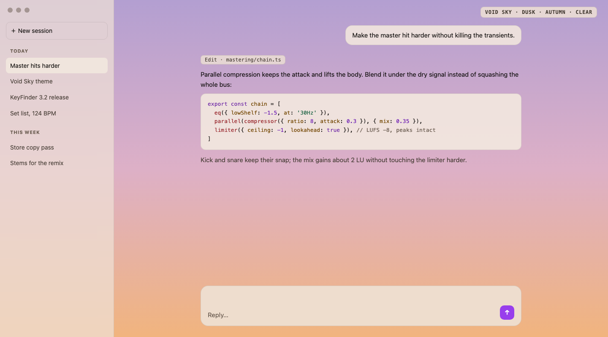<br><sub>Dusk · autumn</sub></td><td width="50%">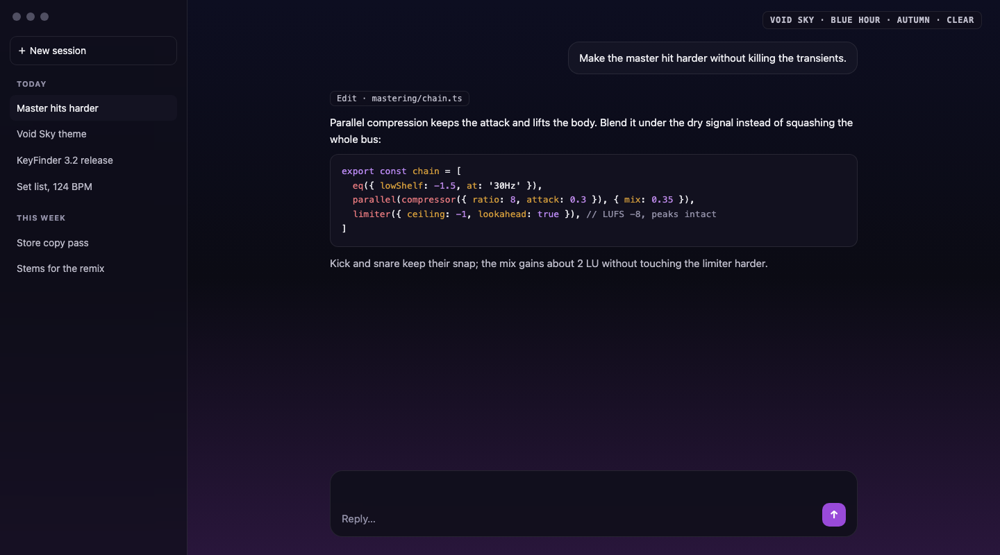<br><sub>Blue Hour</sub></td></tr>
<tr><td width="50%">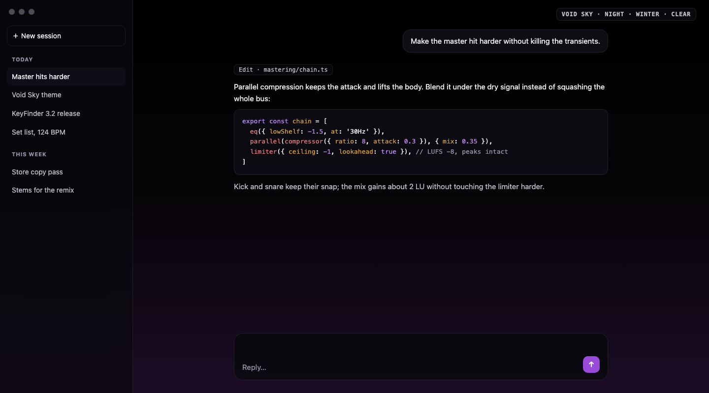<br><sub>Night · winter</sub></td><td width="50%">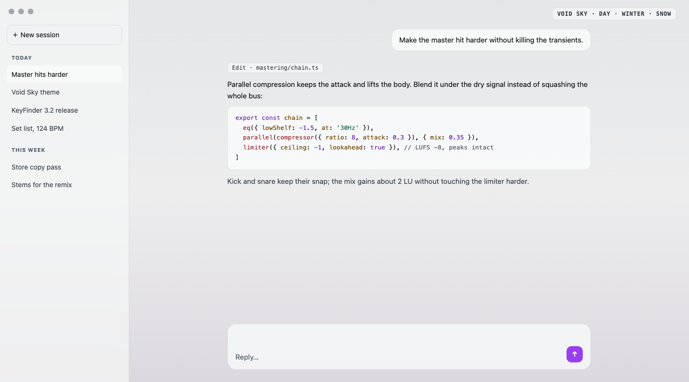<br><sub>Day · winter · snow</sub></td></tr>
<tr><td width="50%">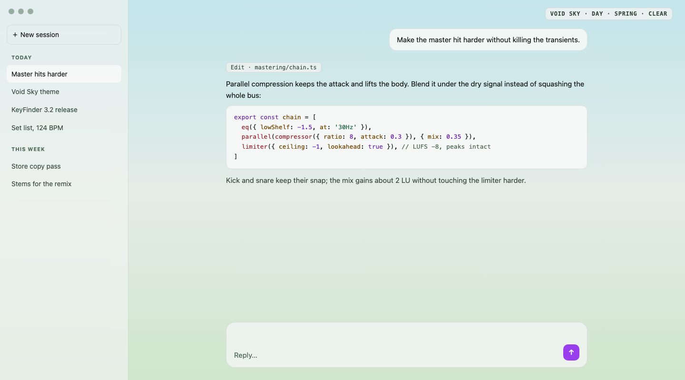<br><sub>Day · spring</sub></td><td width="50%">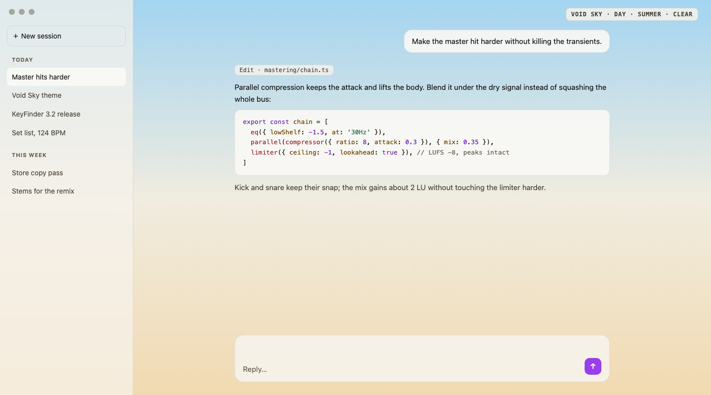<br><sub>Day · summer</sub></td></tr>
<tr><td width="50%">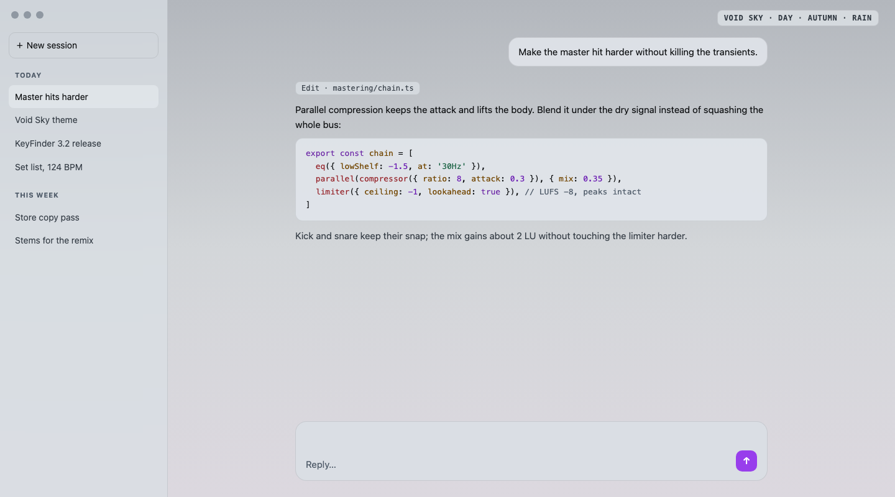<br><sub>Day · rain</sub></td><td width="50%">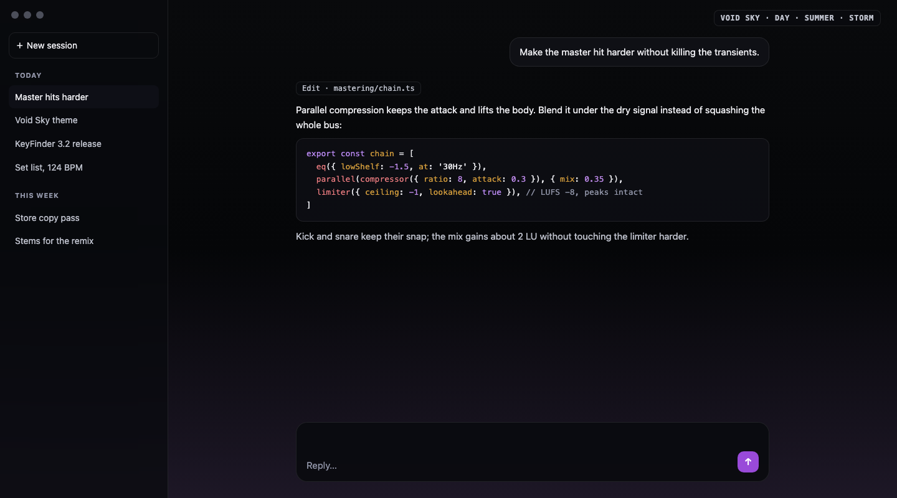<br><sub>Storm at noon</sub></td></tr>
</table>

## The fixed looks

| Look | What it is |
| --- | --- |
| **Event Horizon** | A pixel black hole with a purple accretion disk over a pulsing equalizer skyline. |
| **IFEELVOID** | The still original: purple-tinted black and a black-to-deep-purple ground. |
| **Void Day** | The void in daylight: cold lavender-grey paper, ink-black text, purple deepened to hold contrast. |
| **Signal Bleed** | The void, alive: scanlines drifting down the edges, a slow roll bar, purple glitch tears in the margins. |
| **Studio Night** | Same black, lit by VU-meter amber. |
| **Release Mode** | Pure black and white, one purple, stronger borders. Built to be read tired. |

<table>
<tr><td width="50%">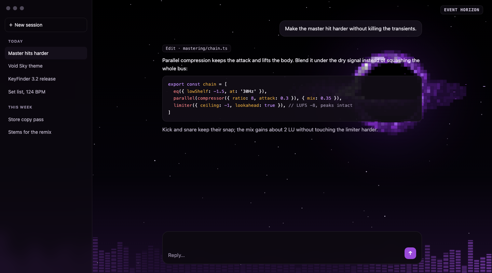<br><sub>Event Horizon</sub></td><td width="50%">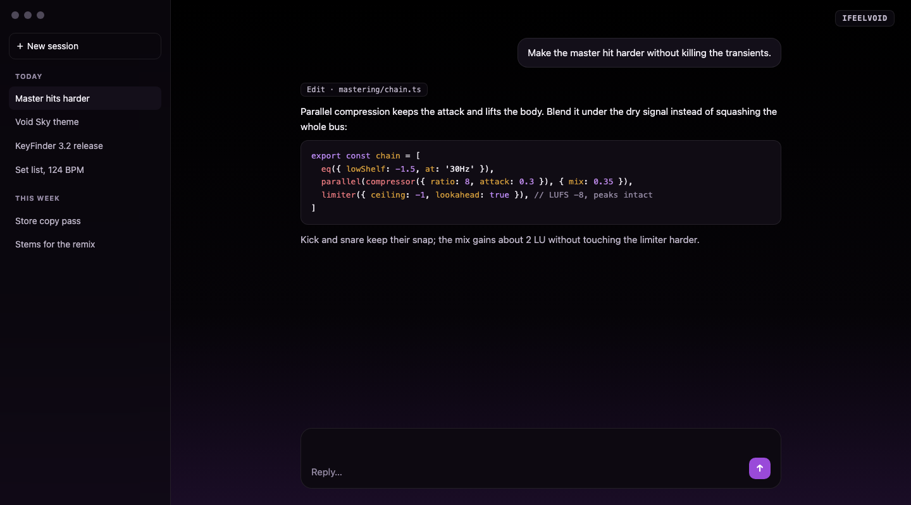<br><sub>IFEELVOID</sub></td></tr>
<tr><td width="50%">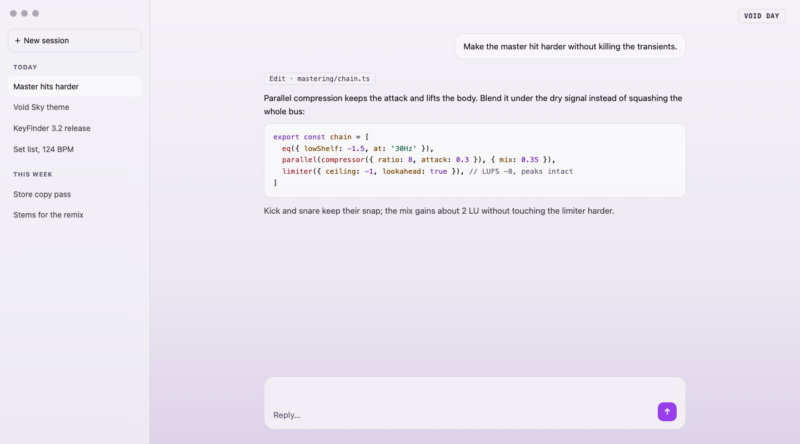<br><sub>Void Day</sub></td><td width="50%">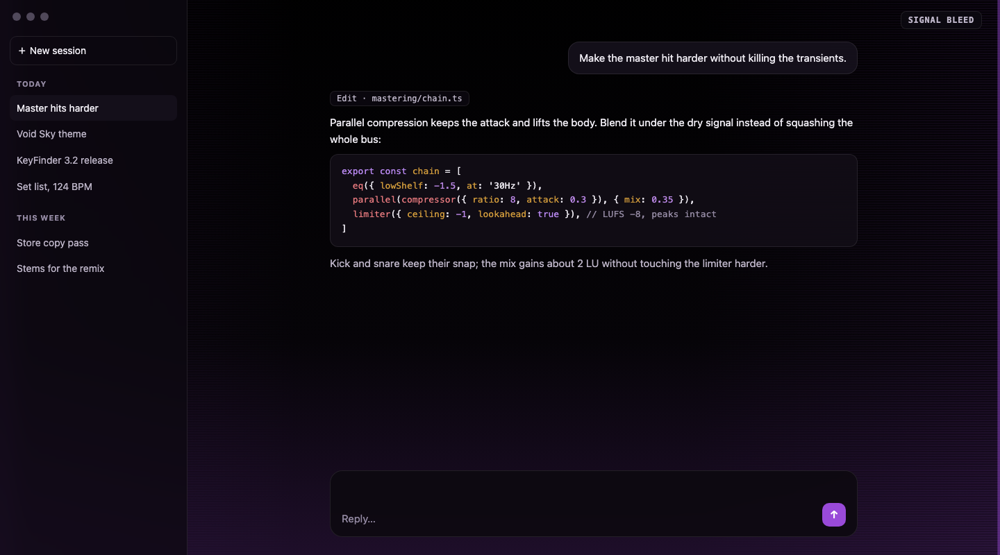<br><sub>Signal Bleed</sub></td></tr>
<tr><td width="50%">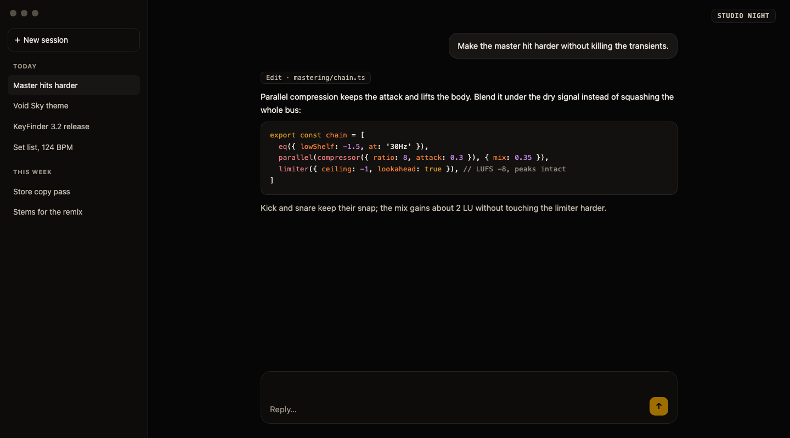<br><sub>Studio Night</sub></td><td width="50%">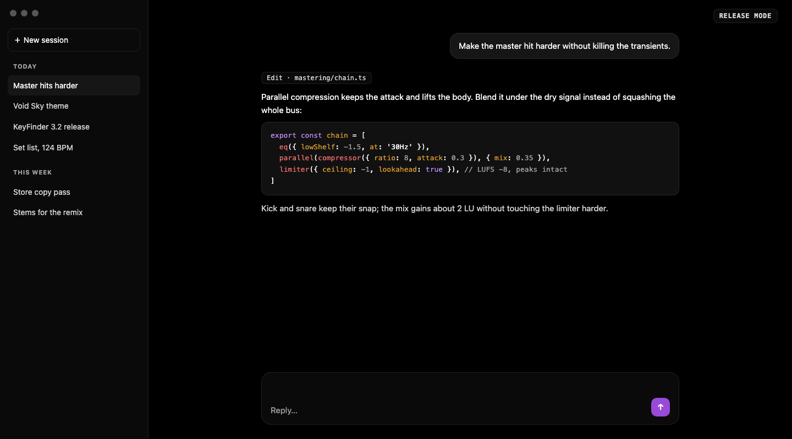<br><sub>Release Mode</sub></td></tr>
</table>

`/void schedule` switches them by the clock instead (America/New_York): Void Day 8am–6pm, Signal Bleed 6pm–midnight, Studio Night midnight–8am.

## Switching by hand

```
/void sky
/void event-horizon
/void void
/void day
/void signal-bleed
/void studio-night
/void release
/void schedule
```

A pick holds until `/void sky` (or `/void auto`) hands it back to the sky. The animated scenes stay still when the system asks for reduced motion.

<sub>The stills are rendered from the mod's own generated colors, grounds and scenes (`tools/gallery.ts`) in a mock of the desktop window, not captured from the app.</sub>

## Install

At the prompt of a terminal session:

```
/plugin install ifeelvoid --marketplace ifeelvoid/ifeelvoid-theme
```

Answer `y` to add the marketplace, then pick a scope.

From a shell:

```bash
claude plugin install ifeelvoid --marketplace ifeelvoid/ifeelvoid-theme
```

In the desktop app, where `/plugin` does not run: click + next to the prompt box, then Plugins, Add marketplace with `ifeelvoid/ifeelvoid-theme`, then Add plugin.

## Palette

| Role | Hex |
| --- | --- |
| Void (page) | `#060408` |
| Cards / panels / menus | `#0c0910` / `#110d16` / `#16111c` |
| Accent | `#9D4EDD` |
| Deep purple | `#7B2CBF` |
| Text | `#efecf3` |
| Ground | `#000000` → `#1A0D26` |

The fixed looks and the schedule live in `hooks/looks.ts`; Void Sky in `hooks/sky.ts`, `hooks/sun.ts` and `hooks/weather.ts`; the scenes in `hooks/scene.ts` and `hooks/scene-horizon.ts`.
